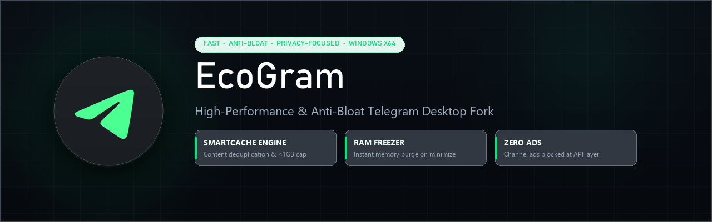

  

  
  
  
  
  

---

## 🌿 Что такое EcoGram?

**EcoGram** — это высокопроизводительный форк официального клиента **Telegram Desktop** для Windows x64. Он создан для тех, кто устал от пожирания оперативной памяти, гигабайтов мусора в папке `tdata` и навязчивых рекламных постов. 

EcoGram сохраняет 100% нативной плавности и функционала оригинального Telegram, но вычищает весь bloatware на уровне C++ ядра.

---

## ⚡ Сравнение с оригинальным Telegram Desktop

| Возможность | Официальный Telegram Desktop | 🌿 **EcoGram** |
| :--- | :---: | :---: |
| **Размер кэша (`tdata`)** | Разрастается до **15–30+ ГБ** | Ограничен в пределах **~500 МБ – 1 ГБ** |
| **Повторяющиеся медиа (стикеры/мемы)** | Дублируются для каждого чата | **Контентная дедупликация** (хранится 1 раз) |
| **Аппетит RAM при сворачивании** | **300 – 800+ МБ** | **~30 – 60 МБ** (RAM Freezer) |
| **Спонсорские посты в каналах** | Принудительно отображаются | **100% вырезаны** на уровне API-запросов |
| **Визуальный стиль и иконка** | Стандартный синий | Эксклюзивный **Dark Cyber** стиль |
| **Оптимизация сборки** | Универсальная | Нативный **MSVC x64** |

---

## 🚀 Архитектура и ключевые модули

### 1. 🛡️ SmartCache Engine (Борьба с раздуванием `tdata`)
Оригинальный Telegram сохраняет копии стикеров, аватарок и видео для каждого диалога отдельно, захламляя накопитель.
- **Content-Defined Deduplication:** хеширование контента исключает дубликаты на уровне виртуальной файловой системы.
- **Cold Cache Purge:** автоматическая ротация кэша каналов, которые вы давно не открывали.
- **Zero Latency VFS:** мгновенный доступ к часто используемым файлам без задержек дискового ввода-вывода.

### 2. 🧊 RAM Freezer (Экономия оперативной памяти)
В Telegram встроены сотни кэшированных растровых поверхностей и текстур.
- При сворачивании окна в панель задач или скрытии в системный трей EcoGram вызывает глубокую очистку рабочего набора страниц памяти (`Working Set Purge`).
- Потребление ОЗУ падает до **30–60 МБ**, возвращая память вашей системе и играм. При разворачивании данные подгружаются без перезапуска клиента.

### 3. 🚫 Zero-Ads SponsorBlock (Чистые каналы)
- Модуль спонсорских сообщений заблокирован на уровне ядра (`SponsoredMessages::canHaveFor = false`).
- Клиент вообще не отправляет запросы `messages.getSponsoredMessages` на серверы Telegram, экономя входящий трафик и очищая каналы от рекламы.

### 4. 🎨 Dark Cyber Identity
- Тёмно-графитовый матовый стиль с акцентным неоново-изумрудным самолётиком.
- Полный комплект нативных `.ico` и PNG-иконок для панели задач, рабочего стола и трея.
- Обновлённое приветственное меню и QR-авторизация в эко-стиле.

---

## 🗺️ План развития (Roadmap)

- [x] **SmartCache & Anti-Bloat:** дедупликация и предотвращение разрастания `tdata`.
- [x] **Windows x64 Native:** полная оптимизация под 64-битные системы.
- [x] **RAM Freezer:** ультра-низкое потребление памяти при сворачивании.
- [x] **SponsorBlock:** полное вырезание рекламы и спонсорских постов в каналах.
- [x] **Dark Cyber Branding:** фирменные иконки и эко-стилистика.
- [x] **Multi-Stream Turbo Downloader:** параллельное скачивание файлов через несколько MTProto-сессий (до 3–5x быстрее).
- [x] **Turbo VoIP Engine:** Safe MTU (1280B без фрагментации в VPN), Studio Opus 64 kbps (фреймы 20ms) и QoS DSCP 46.
- [x] **Smooth PiP Dragging:** устранение 100% нагрузки CPU/GPU при перемещении мини-плеера (кэш монитора, троттлинг драга, заморозка ховеров и исключение конфликтов анимации).
- [ ] **Ghost Mode & Audit:** скрытный просмотр сообщений без отметки о прочтении и локальный аудит изменений.

---

## 📥 Запуск и установка

1. Перейдите во вкладку [Releases](https://github.com/nxvr443/EcoGram/releases) или скачайте последний артефакт сборки из [GitHub Actions](https://github.com/nxvr443/EcoGram/actions).
2. Распакуйте архив `EcoGram-Windows-x64-Debug.zip` в любую удобную папку (например, `C:\EcoGram`).
3. Запустите `Telegram.exe`. Клиент полностью портативный (portable) и хранит данные рядом с исполняемым файлом.

---

## 📜 Лицензия

EcoGram распространяется под лицензией **GNU General Public License v3** с исключением OpenSSL на базе кодовой базы Telegram Desktop.
